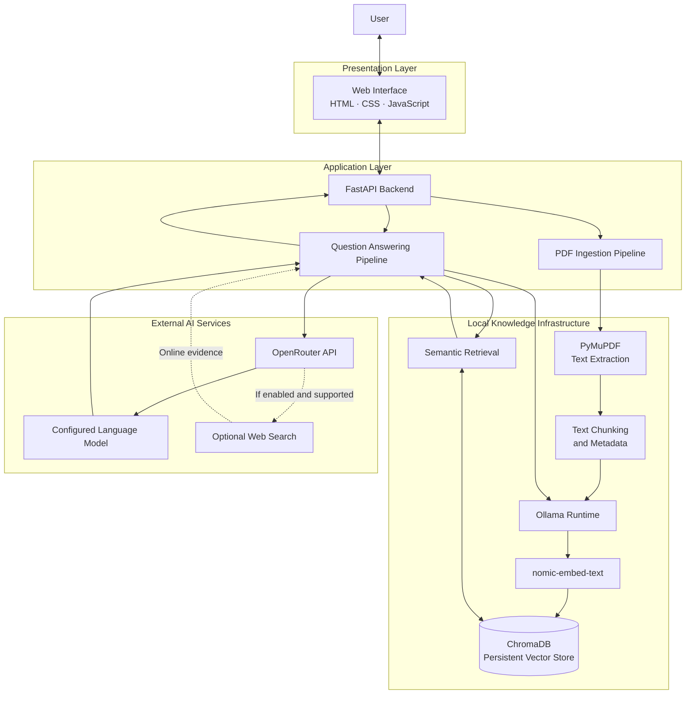

# Industrial Product Intelligence Assistant

### AI-powered industrial document intelligence using Retrieval-Augmented Generation (RAG)

Transform industrial product datasheets, catalogues, and technical manuals into a searchable knowledge base. Ask questions in natural language and retrieve document-grounded answers through a lightweight web interface.

<p align="center">

**FastAPI · Python · Ollama · ChromaDB · OpenRouter**

</p>

---

## Overview

Industrial product information is often spread across lengthy technical manuals, manufacturer catalogues, and product datasheets. Finding a particular specification, application, or installation requirement can require significant manual effort.

The **Industrial Product Intelligence Assistant** is an AI-powered application designed to simplify this process. It combines local document embeddings, semantic search, and large language model capabilities to help users discover and understand technical information.

Users upload PDF documents and ask questions in plain English. The system retrieves relevant passages from the indexed documents and uses them as context for generating an answer. An optional online-search capability can supplement internal documentation when supported by the configured API and model.

### Why this project?

- Reduce the time spent manually searching technical PDFs.
- Make industrial terminology and specifications easier to understand.
- Retrieve relevant information using semantic rather than exact-keyword search alone.
- Ground AI-generated answers in available document evidence.
- Keep embedding generation and vector storage on the local machine.

> **Project status:** Learning MVP / prototype. Retrieval quality, online-search fallback, source attribution, and service-failure handling should be validated before production use.

---

## Key Features

| Feature | Description |
|---|---|
| PDF knowledge base | Upload industrial product datasheets, catalogues, and manuals |
| Semantic retrieval | Find relevant passages based on the meaning of a question |
| RAG-based question answering | Provide retrieved document content as context to the LLM |
| Local embeddings | Generate vectors using Ollama and `nomic-embed-text` |
| Persistent vector storage | Store searchable document chunks and metadata in ChromaDB |
| LLM integration | Generate answers through the OpenRouter API |
| Optional web search | Supplement internal evidence when the integration is configured and supported |
| Browser-based UI | Interact through HTML, CSS, and JavaScript |
| Source-aware responses | Designed to distinguish uploaded-document evidence from online information |

## System Architecture

The application follows a Retrieval-Augmented Generation (RAG) architecture with separate document-ingestion and question-answering workflows.



### How it works

**1. Document ingestion**

The user uploads a PDF. FastAPI validates the file, PyMuPDF extracts its text, and the extracted content is divided into manageable chunks.

**2. Embedding generation**

Ollama runs `nomic-embed-text` locally to convert each text chunk into a numerical vector representation.

**3. Vector storage**

ChromaDB stores the vectors, text chunks, and metadata such as document names and page numbers.

**4. Semantic retrieval**

When a user submits a question, the same embedding model converts the question into a vector. ChromaDB retrieves the closest matching passages.

**5. Answer generation**

The backend sends the question and retrieved evidence to the configured language model through OpenRouter.

**6. Optional online research**

When configured and supported, web search can supplement missing information. Online research must be distinguished from evidence retrieved from uploaded documents.

---

## Technology Stack

| Technology | Role |
|---|---|
| Python 3.11 | Core application language |
| FastAPI | Backend API and request handling |
| Uvicorn | ASGI server |
| HTML5, CSS3, JavaScript | Frontend interface |
| PyMuPDF | PDF text extraction |
| Ollama | Local embedding runtime |
| `nomic-embed-text` | Semantic embedding model |
| ChromaDB | Persistent vector database |
| OpenRouter | Hosted LLM access and supported tool integrations |
| Pydantic Settings | Application configuration |

## Project Structure

```text
Industrial_Product_Assistant/
│
├── app/
│   ├── __init__.py
│   ├── main.py              # FastAPI routes and application entry point
│   ├── config.py            # Environment-based configuration
│   ├── ingestion.py         # PDF extraction and indexing
│   ├── retrieval.py         # Embeddings and semantic search
│   ├── llm.py               # LLM requests and answer generation
│   ├── tools.py             # Supporting application tools
│   │
│   └── static/
│       ├── index.html       # Web interface
│       ├── style.css        # Interface styling
│       └── app.js           # Frontend logic
│
├── data/                    # Local PDFs and vector database (not committed)
├── .env                     # Local secrets (not committed)
├── .gitignore
├── README.md
└── requirements.txt
```

The `data/` and `.env` entries describe local runtime files and should not be published. Actual files may differ depending on your configuration.

---

## Getting Started

### Prerequisites

Install the following before running the project:

- Python 3.11
- Git
- Ollama for Windows
- An OpenRouter account and API key
- An internet connection for hosted LLM requests

### 1. Clone the repository

```powershell
git clone https://github.com/AshrafDesai/Industrial_Product_Assistant.git

cd Industrial_Product_Assistant
```

### 2. Create and activate a virtual environment

```powershell
py -3.11 -m venv .venv

.\.venv\Scripts\Activate.ps1

python -m pip install --upgrade pip
```

### 3. Install dependencies

```powershell
pip install -r requirements.txt
```

### 4. Install and start Ollama

Download Ollama from:

https://ollama.com/download

Pull the embedding model:

```powershell
ollama pull nomic-embed-text
```

Verify that the model is available:

```powershell
ollama list
```

Check the local Ollama API:

```powershell
Invoke-RestMethod http://localhost:11434/api/tags
```

Ollama must be running for local embedding generation and semantic retrieval.

### 5. Configure environment variables

Create a local `.env` file in the repository root. The following is an example of the required configuration; adjust the variable names to match `app/config.py`.

```dotenv
OPENROUTER_API_KEY=YOUR_OPENROUTER_API_KEY
OPENROUTER_MODEL=openrouter/auto
OLLAMA_BASE_URL=http://localhost:11434
OLLAMA_EMBEDDING_MODEL=nomic-embed-text
```

Replace the placeholder with your own API key locally. Never commit `.env`, put credentials in frontend JavaScript, or publish screenshots containing secrets.

### 6. Run the application

From the project root:

```powershell
uvicorn app.main:app --reload
```

Open the application:

**Web interface:** http://127.0.0.1:8000

**API documentation:** http://127.0.0.1:8000/docs

### 7. Use the application

1. Open the web interface.
2. Upload an industrial product PDF.
3. Wait for document indexing to complete.
4. Ask a question about the uploaded document.
5. Review the answer and available source information.
6. Enable online search, if available, when additional external research is needed.

Example questions:

- Explain FLP motors in simple language.
- What applications are mentioned in this datasheet?
- Which motor power ratings are available?
- What installation requirements are listed in the manual?
- Which specifications require verification from the manufacturer?

Answers depend on the quality and contents of the uploaded documents.

---

## API Reference

The prototype is designed to expose the following endpoints. Confirm the exact request schemas in the running API documentation.

| Method | Endpoint | Purpose |
|---|---|---|
| `GET` | `/` | Serves the web interface |
| `GET` | `/api/health` | Reports application and indexing status |
| `POST` | `/api/ingest` | Uploads and indexes a PDF |
| `POST` | `/api/chat` | Submits a question and generates an answer |

Use the interactive API documentation at `http://127.0.0.1:8000/docs` to inspect request bodies, parameters, and responses.

---

## Configuration and Data Flow

| Component | Data handled | Location |
|---|---|---|
| Uploaded PDF | Original document | Local filesystem |
| Document embeddings | Vector representations | Local Ollama + ChromaDB |
| Text chunks and metadata | Searchable evidence | Local ChromaDB |
| API credentials | Authentication secrets | Local `.env` |
| Question and retrieved context | Answer-generation prompt | Sent to OpenRouter |
| Optional web query | Online research request | External search service, when invoked |

### Privacy considerations

Document embeddings are generated locally. However, the application is not fully offline: user questions and retrieved document excerpts may be transmitted to OpenRouter for answer generation. Online search may also contact external services.

Review applicable service policies before processing confidential industrial documents.

---

## Security Considerations

- Keep `.env` out of version control.
- Rotate any API key that has been exposed.
- Exclude virtual environments, databases, uploaded documents, and local logs from Git.
- Validate file uploads and enforce size limits.
- Avoid logging credentials or sensitive document content.
- Treat retrieved document text as untrusted input.
- Do not use AI-generated answers as the sole basis for safety-critical engineering decisions.

## Current Limitations

- Retrieval quality depends on text extraction, chunking, embeddings, and relevance filtering.
- Scanned PDFs may require OCR.
- Tables, diagrams, and complex layouts may not be extracted accurately.
- An LLM may produce incorrect or unsupported statements.
- Web-search functionality depends on API configuration and model/tool compatibility.
- Local retrieval can fail when Ollama is unavailable.
- Source citations and fallback behavior must be verified in the implementation.

**This is a learning MVP, not a certified industrial decision-support system.** Always verify critical specifications, certifications, hazardous-area ratings, and installation requirements against original manufacturer documentation and applicable standards.

---

## Roadmap

- [ ] Improve retrieval relevance and evidence-quality checks
- [ ] Add more reliable document-page citations
- [ ] Improve web-search fallback and source attribution
- [ ] Add OCR for scanned PDFs
- [ ] Improve technical table extraction
- [ ] Compare product specifications across multiple documents
- [ ] Add document-level organization and filtering
- [ ] Add automated retrieval and answer-quality evaluation
- [ ] Introduce authentication and access controls
- [ ] Add structured logging, monitoring, and deployment hardening

---

## Contributing

Contributions, bug reports, and suggestions are welcome.

1. Fork the repository.
2. Create a feature branch.
3. Make and test your changes.
4. Open a pull request with a clear description.

Do not submit API keys, private documents, or confidential datasets.

## License

No license is currently specified. Add a `LICENSE` file before granting public reuse, modification, or distribution rights.

## Author

**Asharafraza Desai**

- GitHub: [AshrafDesai](https://github.com/AshrafDesai)
- LinkedIn: [Ashraf Desai](https://www.linkedin.com/in/ashrafdesai/)

---

*Making industrial product documentation easier to search, understand, and verify.*
